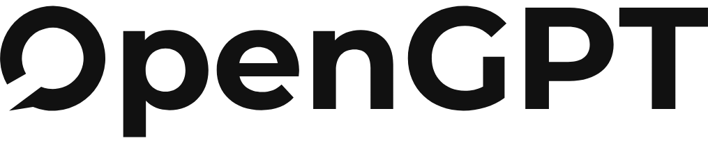

# OpenGPT logo

The **speaking O**: an O left open where a speech tail comes out, an open
conversation. It is also the first letter of the name, so the logo never
shows two O's.

## Two forms

| Form | Files | Use |
|---|---|---|
| **Wordmark**: the speaking O + "penGPT" | `wordmark.svg` (black), `wordmark-white.svg`, `wordmark-currentcolor.svg` | Wherever the name appears: app sidebar and headers, README, docs, social images |
| **Symbol**: the speaking O alone | `symbol.svg`, `symbol-white.svg`, `symbol-currentcolor.svg` | Where the name doesn't fit: collapsed sidebar, favicon, app icon |

Don't place the symbol next to the wordmark: that shows the O twice.

Other files:

| File | Use |
|---|---|
| `app-icon.svg` | White symbol on a dark rounded tile (`#202123`) |
| `banner.svg`, `png/banner.png` | White wordmark centred on a dark rounded strip (4:1, PNG 3200×800). Reads on light and dark pages: Docker Hub overview, social posts |
| `png/` | App icon 32/512/1024 px; symbol and wordmark 1024 px, black and white |
| `favicon/` | `favicon.ico`, `favicon.svg`, 16/32/48 px, `apple-touch-icon.png`, 192/512 px, maskable 512 px, `site.webmanifest`, and `head-snippet.html` (the `<link>` tags). Copied into `frontend/public/` |

In the app the logo is `frontend/src/components/Logo.jsx` (`Logo` and
`LogoMark`), built from these files.

All SVGs are hand-built vector paths: no embedded images, live text, filters
or scripts.

## Rules

- **Colours:** one colour. Black `#111111` on light, white `#FFFFFF` on dark;
  the app icon uses `#202123` behind white.
- **Clear space:** at least the height of the "e" on every side of the
  wordmark; a quarter of its width around the symbol.
- **Minimum size:** wordmark 20 px tall (below that, use the symbol); symbol
  16 px.
- **Don't:** stretch, rotate, outline, add shadows or gradients, put the black
  version on dark backgrounds, add a second O, or reset the name in another
  font.

## Construction

- **Symbol** (256 canvas): ring centred at 136,120, outer radius 92, inner
  56. The opening runs from 110° to 155° (clockwise from 3 o'clock), and the
  tail leaves the 110° end to a point at 56,222.
- **Wordmark O:** the same idea drawn at text size: a ring the height of a
  round capital (724 units, with overshoot) and a stroke of 150 units to match
  the letters. The opening is narrower (112° to 150°) and the tail stops at
  the baseline, so it reads as a letter first.
- **Lettering:** "penGPT" is Montserrat Bold, converted to outlines, tracked
  −0.01 em. Montserrat is under the SIL Open Font License, which allows logo
  use.

## Before registering

The mark is original, built from simple geometry, but that doesn't guarantee
nothing similar exists. Have a professional trademark search done before
registering it.
